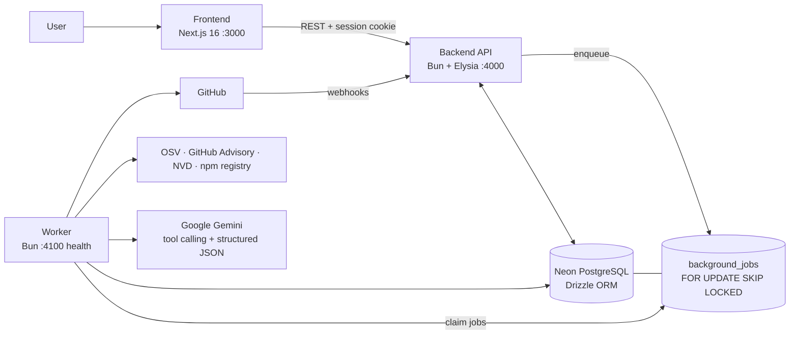

# RepoSec: from vulnerability detection to verified remediation

> Connect GitHub. RepoSec finds the vulnerable dependencies in your repositories, researches each one like a security engineer would, tells you whether **your code** is actually exposed, and opens a fix PR. Then it checks that the fix really worked.

Built at **Hack Day NFSU**.

---

## The problem

Scanners already tell you *"you have 172 advisories"*. What they leave to you is everything after that:

- Which of these actually affect *my* code, and which are noise?
- What is the official fix, and what breaks if I upgrade?
- Who writes the upgrade PR, and did CI (or the fix itself) really resolve it?

Developers burn hours per vulnerability reading advisories, changelogs and migration guides. RepoSec automates that whole investigation loop.

## What it does

1. **Sign in with GitHub**, install the RepoSec GitHub App and pick the repositories to monitor.
2. **Analyze** each repository at an exact commit. The full dependency tree (direct and transitive, with the dependency path) comes from the lockfile.
3. **Detect** known vulnerabilities from **OSV, GitHub Advisory Database and NVD**, deduplicated across sources (a CVE and a GHSA for the same flaw count once).
4. **Investigate** the riskiest packages with **Google Gemini**: official fix, patched version, changelog, breaking changes, migration path, and whether the vulnerable code is actually used in the repo. Every claim carries evidence and a source link.
5. **Remediate** in one of two ways: **open a pull request** (branch plus manifest change plus a full PR body), or **copy an AI remediation prompt** built from real repo data, to paste into your own coding agent.
6. **Verify.** After merge, the resulting lockfile is re-analyzed to confirm the vulnerable version is gone. CI results are tracked separately, because a green build does not prove the vulnerability is fixed.
7. **Monitor continuously.** Push webhooks trigger re-analysis, and a scheduler re-checks advisories so new CVEs show up on old commits.

## Highlights

- **Evidence-first AI.** A finding is only "confirmed" with a source URL. Official, advisory-database and community sources are labelled separately. Reachability is claimed only from actual code usage.
- **Deterministic facts beat the model.** Patched versions, severity and CVSS come from advisory data and semver resolution, and override whatever the LLM says.
- **Honest numbers.** "Outdated" is never added to vulnerability totals. Latest vs. latest-stable vs. latest-compatible versions are kept apart.
- **Ranked by risk, not CVSS alone.** Priority combines severity, direct vs. transitive, patch availability and verified reachability.
- **Never executes your code.** Repositories are read as text via the GitHub API. The AI only sees excerpts and metadata.
- **Never touches your default branch and never merges.** PRs go on a `security/SEC-<id>-<pkg>` branch.
- **Real progress.** The UI polls actual worker stage states (9 stages), with no fake progress bars.
- **Fast dashboard.** Stale-while-revalidate cache with every tab prefetched, so switching tabs is instant. The Overview has live charts (severity mix, exposure per repository, trend over time, dependency health, remediation PRs).

## Real run

Run against a real private repository (`tejasnasre/communex`):

| | |
|---|---|
| Packages analyzed | **552** (62 direct, 490 transitive) |
| Vulnerable packages | **27** |
| Advisory-level findings | 172 (9 critical, 73 high, 73 medium, 17 low) |
| Unique advisories after cross-source dedup | 122 |
| AI investigations completed | 6 (top packages by risk) |
| Scan time | about 5 minutes for the full pipeline |

---

## Architecture

Three independently deployable processes, with no long-running work inside HTTP requests.



| Process | Responsibility |
|---|---|
| **Frontend** (`frontend-hackday/`) | Landing page, dashboard (Overview, Repositories, Findings, Vulnerabilities, Investigations, Remediation PRs, Activity, Notifications, Settings) |
| **Backend API** (`backend-hackday/`) | Auth, GitHub App flows, REST API, webhook receiver (HMAC-verified, idempotent), job enqueueing |
| **Worker** (`backend-hackday/src/worker/`) | Repository snapshot, lockfile parsing, advisory intel, Gemini investigations, report, notifications, advisory refresh scheduler |

**Analysis pipeline** (stored per analysis in `analysis_stages`): connect repository, fetch latest commit, extract dependencies, fetch package metadata, check vulnerabilities, research advisories, investigate packages, generate report, send notifications.

**Job queue.** PostgreSQL-backed, with retry and exponential backoff, timeouts, dead-lettering, a stale-lock reaper and graceful shutdown. Pushes to the same repository coalesce into one queued job, and the same commit is never analyzed twice.

### Tech stack

| Layer | Choice |
|---|---|
| Frontend | Next.js 16 (App Router, Cache Components), React 19, TypeScript, Tailwind CSS 4, shadcn/ui on Base UI, TanStack Query, Recharts |
| Backend | Bun, Elysia, TypeScript (strict) |
| Database | Neon PostgreSQL, Drizzle ORM with migrations, node-postgres |
| Auth | Better Auth with GitHub OAuth. Repository access uses a **GitHub App**, never the login token |
| AI | Google Gemini only (function calling, structured JSON, optional Search grounding) |
| Email | Resend (optional) with a delivery log |

### Supported ecosystems

JavaScript / TypeScript: `package-lock.json` (v1/2/3), `pnpm-lock.yaml` (v6/v9), `yarn.lock` (v1 and Berry), `bun.lock`. Monorepo and workspace aware. The analyzer is built so other ecosystems can be added later.

---

## Security model

RepoSec handles private source code, so the design is deliberately conservative:

- **Least privilege.** The GitHub App is repo-scoped. Installation tokens are never stored, logged or returned. The install callback proves the user owns the installation before linking it.
- **Authorization on every id.** Repository, plan and finding ids from the client are never trusted. Ownership is checked server-side.
- **Webhooks** are HMAC-SHA256 verified and idempotent on `X-GitHub-Delivery`.
- **AI hardening.** Tool output is wrapped as untrusted data, with prompt-injection rules. URL fetching uses an SSRF-safe allowlist. There are 20 tools with strict schemas.
- **Abuse protection.** Per-IP rate limits, 10 per minute on PR creation, an audit log table, and secret-free logging.

---

## Run it locally

### Prerequisites

- [Bun](https://bun.sh) 1.4+
- A [Neon](https://neon.tech) Postgres database (use the **pooled** connection string)
- A **GitHub OAuth app** (login) and a **GitHub App** (repo access and PRs)
- A [Gemini API key](https://aistudio.google.com/apikey)

### 1. Configure

```bash
cd backend-hackday  && cp .env.example .env   # fill in the values below
cd ../frontend-hackday && cp .env.example .env.local   # NEXT_PUBLIC_API_URL=http://localhost:4000
```

| Variable | Required | Notes |
|---|---|---|
| `DATABASE_URL` | yes | Neon pooled string, `sslmode=require` |
| `BETTER_AUTH_URL` / `FRONTEND_URL` | yes | `http://localhost:4000` / `http://localhost:3000` |
| `BETTER_AUTH_SECRET` | yes | `openssl rand -base64 32` |
| `GITHUB_CLIENT_ID` / `GITHUB_CLIENT_SECRET` | yes | OAuth app. Callback: `http://localhost:4000/api/auth/callback/github` |
| `GITHUB_APP_ID` / `GITHUB_APP_SLUG` / `GITHUB_APP_CLIENT_ID` / `GITHUB_APP_CLIENT_SECRET` | yes | GitHub App. Callback: `http://localhost:4000/api/v1/github/installations/callback` |
| `GITHUB_APP_PRIVATE_KEY` | yes (for scans) | PEM on one line with literal `\n`, or a path to the `.pem` |
| `GEMINI_API_KEY` | yes (for AI) | Backend and worker only, never exposed to the browser |
| `GEMINI_MODEL` | no | Defaults in `.env.example` |
| `GEMINI_SEARCH_ENABLED` | no | `false` on free keys (Search grounding needs a paid key) |
| `GITHUB_WEBHOOK_SECRET` | for webhooks | `openssl rand -hex 32`, same value on the GitHub App |
| `RESEND_API_KEY` / `EMAIL_FROM` | no | Without a key, emails are logged as `skipped` and notifications stay in-app |
| `INVESTIGATION_LIMIT`, `WORKER_CONCURRENCY`, `ADVISORY_REFRESH_MINUTES`, `NVD_API_KEY` | no | Pipeline tuning |

The GitHub App needs repository **Contents** (read and write, for the fix branch), **Pull requests** (write), **Metadata** (read), and **Checks** and **Actions** (read). Subscribe to the Push, Pull request, Check run, Check suite and Workflow run events.

### 2. Install and migrate

```bash
cd backend-hackday  && bun install && bun run db:migrate
cd ../frontend-hackday && bun install
```

### 3. Start the three processes

```bash
cd backend-hackday  && bun run dev      # API      http://localhost:4000
cd backend-hackday  && bun run worker   # Worker   http://localhost:4100  (required for scans)
cd frontend-hackday && bun run dev      # Web app  http://localhost:3000
```

Open <http://localhost:3000>, sign in with GitHub, install the app, connect a repository and watch the analysis run.

> **Webhooks** (push-triggered rescans, CI, merge verification) need a public URL. Run `ngrok http 4000` or `cloudflared`, then set the GitHub App's webhook URL to `https://<tunnel>/api/v1/webhooks/github`. Everything else works without it.

### Checks

```bash
cd backend-hackday  && bun check                                  # type check
cd frontend-hackday && bunx tsc --noEmit && bunx eslint app components hooks lib proxy.ts
```

---

## Repository layout

```
.
├── frontend-hackday/        Next.js app (dashboard UI)
│   ├── app/                 routes (landing + /dashboard/*)
│   ├── components/          UI, views (cached list pages), charts
│   └── lib/                 API client, query cache, types
├── backend-hackday/         Elysia API + worker
│   ├── src/routes/          REST endpoints
│   ├── src/services/        analysis, reports, remediation, notifications, CI, verification
│   ├── src/lib/             deps parsers, intel clients, Gemini + tools, GitHub, queue, cache
│   ├── src/worker/          worker entrypoint
│   ├── src/db/schema/       Drizzle schema
│   └── drizzle/             migrations
├── Product.md               full product spec (source of truth for scope)
└── TASKS.md                 build progress, decisions, known gaps
```

## Status and honest limitations

| Area | State |
|---|---|
| GitHub login, App install, repo selection | Done and verified |
| Queue, worker, lockfile analysis | Done, verified on a real private repo |
| OSV / GitHub Advisory / NVD intelligence, dedup, severity | Done, verified |
| Gemini investigations, evidence model, reports | Done, verified (6 investigations) |
| Remediation prompt | Done, verified |
| **Create GitHub PR** | Built and type-checked, **not executed yet** (it would push a real branch to a real repo) |
| Post-merge verification, CI correlation | Built, **untested** (needs webhooks and a merged PR) |
| Email delivery | Built. Needs `RESEND_API_KEY`, otherwise logged as `skipped` |

Known gaps:

- The PR changes the **manifest only**. The lockfile is not regenerated and tests are not run by RepoSec (repo code is never executed on our host). The PR body says so, and the merged lockfile is re-analyzed to verify. A sandboxed runner would be the next step.
- Rate limits are in-memory per process (a Redis-backed limiter and CSP headers are not done yet).
- The Overview headline counts advisory-level findings (172 for the test repo, versus 27 vulnerable packages). "Packages affected" is worth surfacing as well.
- Gemini Search grounding is off on free keys, so official sources come from the GitHub, npm, NVD and OSV fetch tools.
- A full scan of a ~550-package repo takes about 5 minutes. Advisory enrichment is sequential and could be parallelized.

See [TASKS.md](TASKS.md) for the detailed build log and [Product.md](Product.md) for the full spec.
